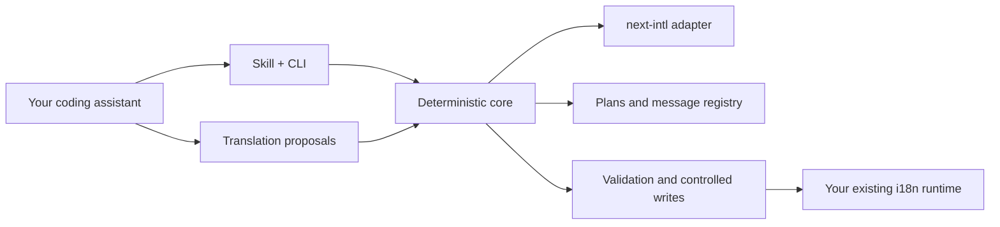

# i18n-companion

**Install it once into Claude Code, Codex or Cursor, and your coding agent localizes as it builds.
If it ever forgets, CI catches it before anyone sees it. Reviewed translations are never overwritten.**

Your i18n library, your catalogs, your model.

> [!IMPORTANT]
> **Design stage.** Nothing is published yet. Every command, output and transcript below shows the
> *intended* experience; the `i18n-companion` package is not on npm yet. We're looking for
> [pilot apps and contributors](#get-involved).

**Pilot scope:** Next.js App Router · [next-intl](https://next-intl.dev) with JSON (ICU) catalogs ·
English source · French, Hindi and Arabic (right-to-left) targets.

---

## Contents

1. [Install](#1-install)
2. [Ask your assistant](#2-ask-your-assistant)
3. [Review the diff](#3-review-the-diff)
4. [See it running](#4-see-it-running)
5. [Just build](#5-just-build)
6. [When the wording changes](#6-when-the-wording-changes)
7. [Validation and CI](#7-validation-and-ci)
8. [When it can't help](#8-when-it-cant-help)
- [How it compares](#how-it-compares)
- [How it works](#how-it-works)
- [Roadmap](#roadmap)
- [Get involved](#get-involved)

---

## 1. Install

One command detects your project, asks one question, and previews every file before writing it.
It never rewrites your existing agent instructions.

```console
$ npx i18n-companion init

Detecting project…
  ✓ package manager   pnpm (workspace root)
  ✓ framework         Next.js 15 · App Router · src/app
  ✓ i18n library      next-intl 4 · useTranslations / getTranslations
  ✓ catalogs          ./messages/{en,fr}.json  (ICU)
  ! also found        useExtracted in src/app/blog/**  → audit only, different adapter

? Setup
  Assistant         › Claude Code   Codex   Cursor   copy-paste runbook
  Source locale     en
  Target locales    fr, hi, ar      (fr already has 212 reviewed messages, they stay)
  Translation mode  › assistant     no API key; your assistant's model translates
  Always-on rule    › yes           1 line in CLAUDE.md, so new UI text is localized unasked

Will write:
  + i18n-companion.config.ts
  + .claude/skills/i18n-companion/SKILL.md          v0.1.0, owned by installer
  + .i18n-companion/registry.json                   message ids, revisions, review state
  ~ .gitignore                                  + .i18n-companion/work/
  ~ CLAUDE.md                                   + 1 line, nothing else touched
? Write these 5 files? Yes

✓ Ready. Try in Claude Code: "Localize the checkout screen into fr, hi and ar"
  Undo any time: npx i18n-companion uninstall --preview
```

| Assistant   | Skill installed to                     | Always-on rule |
| ----------- | -------------------------------------- | -------------- |
| Claude Code | `.claude/skills/i18n-companion/SKILL.md`   | `CLAUDE.md`    |
| Codex       | `.agents/skills/i18n-companion/SKILL.md`   | `AGENTS.md`    |
| Cursor      | `.cursor/skills/i18n-companion/SKILL.md`   | `AGENTS.md`    |

## 2. Ask your assistant

You ask in plain words. The assistant runs the CLI for the mechanical work (finding strings,
planning edits, checking ICU) and does the language work itself.

> **You:** Localize the checkout screen into French, Hindi, and Arabic. Preserve our current routing
> and server/client boundaries. Show the plan, apply supported changes, and report anything that
> needs a manual decision.

```console
i18n-companion doctor --json                             supported · next-intl
i18n-companion audit --paths src/app/checkout --json     14 found · 2 need you
i18n-companion plan --paths src/app/checkout             plan p-0c41 · 12 messages · 3 files
i18n-companion batch --plan p-0c41 --next                batch-17 · 12 × 3 locales
i18n-companion import --plan p-0c41 --input batch.json   35 staged · 1 retried
i18n-companion check --plan p-0c41 && … apply            applied · 5 files
pnpm typecheck && pnpm test && pnpm build            passed
```

> **Assistant:** Done: checkout now works in en, fr, hi and ar.
> - Your translator's 3 reviewed French messages were kept as they were.
> - Hindi and Arabic are **draft** until someone reviews them.
>
> Two questions for you:
> - Line 41 builds a key at runtime. Add the 4 order states as explicit messages?
> - Is "Save" on line 58 a verb or a discount label? I left it alone.

## 3. Review the diff

Edits are made at exact source ranges, so nothing else in the file is reformatted. A sentence that
was glued together from pieces becomes one message with a named argument.

```diff
 // src/app/checkout/page.tsx — still an async Server Component
+import {getTranslations} from 'next-intl/server';
 import {getCart} from '@/lib/cart';

 export default async function CheckoutPage() {
   const {user, cart} = await getCart();
+  const t = await getTranslations('Checkout');
   return (
-      <h1>Checkout</h1>
-      <p>Hello {user.name}</p>
+      <h1>{t('title')}</h1>
+      <p>{t('welcome', {name: user.name})}</p>
```

Each locale gets the plural forms its language actually uses. Arabic has six:

```json
{
  "Checkout": {
    "title": "الدفع",
    "welcome": "مرحبًا {name}",
    "items": "{count, plural, zero {لا توجد عناصر} one {عنصر واحد} two {عنصران} few {# عناصر} many {# عنصرًا} other {# عنصر}}",
    "payNow": "ادفع الآن"
  }
}
```

## 4. See it running

| Message           | en          | fr                 | hi                  | ar           |
| ----------------- | ----------- | ------------------ | ------------------- | ------------ |
| `Checkout.title`  | Checkout    | Paiement           | चेकआउट               | الدفع        |
| `Checkout.items` (3) | 3 items  | 3 articles         | 3 आइटम              | 3 عناصر      |
| `Checkout.payNow` | Pay now     | Payer maintenant   | अभी भुगतान करें       | ادفع الآن    |

Prices and counts are formatted with `Intl` for each locale, Arabic renders right-to-left, and a
pseudo-locale (`en-XA`) stretches every string so you can spot layouts that break with longer text.
Product names stay as they are: they are data, not UI.

## 5. Just build

You never mention translations. The one-line rule from setup is loaded on every task, so when the
agent writes new UI, the text goes into your catalogs and the other languages get drafts.

> **You:** Add a notification settings page with toggles for email and SMS.

```tsx
const t = await getTranslations('Settings.notifications');

<h1>{t('title')}</h1>
<Switch name="email" label={t('email')} />
<Switch name="sms" label={t('sms')} description={t('smsHint')} />
<Button>{t('save')}</Button>
```

> **Assistant:** Added the notification settings page at /settings/notifications. All 6 labels go
> through next-intl. French, Hindi and Arabic drafts are ready for review.

If it ever forgets, CI stops it:

```console
$ i18n-companion check --changed

✗ I18N_HARDCODED_STRING
    src/app/settings/notifications/quiet-hours.tsx:34
    "Quiet hours start at"
    fix: ask your assistant to "localize the changed files"

exit 1
```

The rule makes localizing the default; the check makes it guaranteed. CI is still there because an
agent can miss a string, a teammate may not have the skill installed, and code written by hand never
passes through the agent.

**Benchmark (planned):** 20 everyday feature requests that never mention translations, run with no
i18n-companion, with the skill only, and with the skill plus the one-line rule. We'll publish the
results for each supported assistant before v0.1, along with the prompts, so anyone can rerun them.

## 6. When the wording changes

Each message has a stable id and a revision of its source text. Edit the English and only that
message's translations go stale. A translator's reviewed wording is never overwritten: the new
suggestion sits next to it as a proposal.

| State               | Meaning                          |
| ------------------- | -------------------------------- |
| `missing`           | No translation yet               |
| `draft`             | Machine text, not checked        |
| `machine-validated` | Structure checked                |
| `human-reviewed`    | A person approved it             |
| `stale`             | The source changed since         |

Example: `Checkout.payNow` changes from "Pay now" to "Pay securely".

| Locale | Before                              | After the source edit | After "update translations"                          |
| ------ | ----------------------------------- | --------------------- | ---------------------------------------------------- |
| fr     | Payer maintenant · `human-reviewed` | `stale`, text kept    | kept, with proposal "Payer en toute sécurité"        |
| hi     | अभी भुगतान करें · `machine-validated`  | `stale`, text kept    | सुरक्षित भुगतान करें · `machine-validated`                |
| ar     | ادفع الآن · `draft`                 | `stale`, text kept    | ادفع بأمان · `machine-validated`                     |

An optional `i18n-companion watch` notices edits as you save and queues the work for your assistant
(or, in provider mode, finishes it unattended).

## 7. Validation and CI

Every answer from the model is checked before it is staged: allowed ids only, the current source
revision, valid ICU, the same placeholder names. A bad answer is retried once with the exact error,
then left out and reported, and the app keeps showing the source-language fallback.

```console
✗ I18N_PLACEHOLDER_MISMATCH  fr  Checkout.welcome
    source   "Hello {name}"
    answer   "Bonjour {nom}"
    expected placeholder {name}, got {nom}

✗ I18N_STALE_REVISION  hi  Checkout.payNow
    answer was for sha256:4e1a…, current is sha256:9b07…
    late result discarded; message re-queued

✗ I18N_UNEXPECTED_ID  ar  Checkout.refundPolicy
    not in batch-17; ignored
```

```console
$ i18n-companion check --json

  locales     en   fr   hi   ar
  coverage   100  100  100  100
  reviewed   100   97   18   12   % human-reviewed
  stale        0    1    1    1

✓ ICU syntax valid in 4 catalogs
✓ no hardcoded strings in changed files
! 3 stale translations (Checkout.payNow)
! policy: payment copy needs human review in hi, ar
```

## 8. When it can't help

On a setup it doesn't support yet, it says so and changes nothing.

```console
$ npx i18n-companion doctor

  ✓ framework     Next.js 15 · App Router
  ✗ i18n library  i18next 23 + react-i18next
                  no adapter yet (planned after the pilot)
  ✗ catalogs      public/locales/{lng}/{ns}.json
                  i18next format, not ICU

Nothing was changed.
Audit written to .i18n-companion/work/audit.md
  142 candidate strings · 9 files · 3 dynamic keys

For this setup today, i18next-cli covers extraction and sync.
```

**It will never:**

- install a second i18n library next to yours
- mix catalog formats in one project
- add `"use client"` to make a migration pass
- restructure your locale routing
- overwrite a translation a person reviewed
- write outside the files it showed you first

---

## How it compares

Good tools already exist. Use the one that fits.

| Tool | Built around | Choose it when |
| --- | --- | --- |
| [i18next-cli](https://github.com/i18next/i18next-cli) | Extraction, instrumentation and sync for i18next, with its own agent runbook | Your app uses i18next or react-i18next |
| [Lingo.dev Compiler](https://lingo.dev/en/docs/react/compiler/vite-react) | Compile-time localization for React, updating translations as you develop (alpha) | You'd rather not manage message keys yourself |
| [next-intl agent workflows](https://next-intl.dev/docs/workflows/agents) | The library's own guidance for working with AI agents | You want the official path and are happy to steer the agent yourself |
| **i18n-companion** | A companion for the assistant you already use: stable message ids, review states and validation kept in your repo | You have next-intl catalogs and reviewers, and want each change to touch only what changed |

Before v0.1 we will run all of these on the same real apps and publish the results, including where
they do better.

## How it works

A small deterministic core, with the model at the edges.

| The assistant does | The CLI guarantees |
| --- | --- |
| Understands what you asked and which screens you mean | Finds strings with a TypeScript AST, not regex |
| Translates batches with product context and a glossary | Stable message ids that survive file moves |
| Asks about ambiguous strings ("Save" the verb vs. the discount) | Validates ICU, placeholders, plurals and revisions |
| Summarizes changed files and what it could not do | Refuses to apply a plan if files changed since planning |
| | Never runs a command that a translation response suggests |



**Who translates?**

| Mode | Translator | Runs unattended? |
| --- | --- | --- |
| Assistant (default) | The model in your current assistant session | No |
| Bring your own provider | A model or translation API you configure, server-side | Yes, while the worker runs |

Assistant mode needs no extra API key, and your code is never sent to us.

**Planned packages**

```text
packages/
  core/                    registry, plans, revisions, diagnostics, validation
  cli/                     init · doctor · audit · plan · batch · import · check · apply · watch
  adapter-next-intl/       first framework and catalog adapter
  assistant-integration/   one skill template, installed for each assistant
  mcp/                     later: stdio wrapper over the same core
  runtime-server/          later: opt-in translation of dynamic content
```

**Proposed config**

```ts
export default {
  sourceLocale: 'en',
  targetLocales: ['fr', 'hi', 'ar'],
  adapter: 'next-intl',
  messagesDir: './messages',
  include: ['src/app/**/*.{ts,tsx}', 'src/components/**/*.{ts,tsx}'],
  exclude: ['**/*.test.*', '**/*.stories.*', '**/generated/**'],
  translation: { mode: 'assistant' },
  reviewedTranslations: 'preserve',
  checks: ['typecheck', 'test', 'build'],
};
```

## Roadmap

| | Milestone | Done when |
| --- | --- | --- |
| M0 | Compare existing tools | Two real apps run through current tooling; the gap is named and measurable |
| M1 | Core and audit | Read-only audit is reproducible on a supported and an unsupported project |
| M2 | next-intl adapter | A checkout screen works in the pilot locales; a second run makes no changes |
| M3 | Existing-assistant workflow | Claude Code or Codex completes the workflow with no extra API key |
| M4 | Daily maintenance | One source edit updates only the affected translations and keeps human edits |
| M5 | Portability | More assistants, optional MCP server |
| M6 | Provider automation | Watch and CI can finish without an interactive session |
| M7 | Dynamic content | Opt-in server API with cache, fallback and tenant isolation |

## Get involved

The project is at the design stage. The fastest way to make it useful is to try it on real apps and
real languages early. [Open an issue](../../issues/new) to:

- **Lend an app for the pilot**: a Next.js app on next-intl, or a small one with no i18n yet. We'll
  localize one screen and share what broke.
- **Review translations**: native speakers of French, Hindi, Arabic, or the language you want next.
- **Build an adapter**: i18next, Lingui and FormatJS are next. The core is designed so adapters stay small.
- **Tell us what's missing**: which step in your localization work still needs a person every time?

## License

[MIT](LICENSE)
